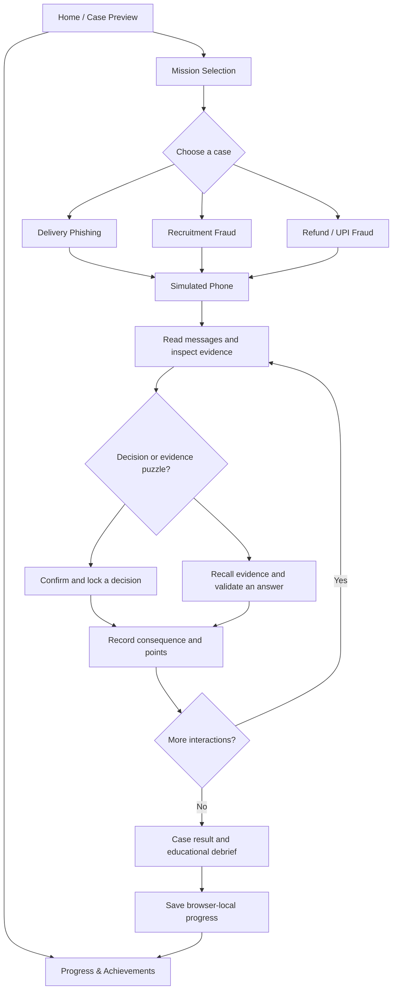
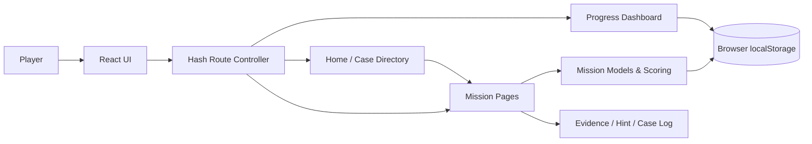

# ScamSignal

> **The internet is testing you. Can you spot the scam?**  
> An interactive, browser-based cyber-defense investigation game about delivery phishing, fake recruitment offers, and UPI/refund fraud.

[](https://react.dev/)
[](https://www.typescriptlang.org/)
[](https://vite.dev/)
[](https://vitest.dev/)
[](https://scamsignal-krish-2026.embarko.app)


**ScamSignal** turns common online scams into short, consequential investigations. Instead of reading a list of generic warning signs, players work through convincing fictional messages, inspect evidence, choose responses, and see how their decisions affect the outcome. Every mission ends with an opportunity to understand the warning signals and improve the next decision.

The experience runs in a simulated smartphone interface and is designed to be **anonymous-first, educational, and safe to explore**. It does not ask users to transfer money, reveal a UPI PIN, contact actual scammers, or submit real identity documents. The playable cases and scoring rules are defined in the frontend source; progress is saved in the browser.


**Live application:** **[Play ScamSignal on Embarko](https://scamsignal-krish-2026.embarko.app)**  
**Hosting:** Live on Embarko; claimed under the maintainer's workspace (confirmed November 22, 2026).  
**Development status:** Three playable cases, cross-case progress tracking, achievements, responsive interface, and automated release validation implemented.

**[Launch the game](https://scamsignal-krish-2026.embarko.app)** · **[Choose a mission](https://scamsignal-krish-2026.embarko.app/#/missions)** · **[View progress](https://scamsignal-krish-2026.embarko.app/#/progress)**

> **No account or payment required to play.** Progress and achievements are stored in the current browser, not synchronized across devices.


---

## Contents

- [Why ScamSignal matters](#why-scamsignal-matters)
- [Current implementation](#current-implementation)
- [The three investigations](#the-three-investigations)
- [Core gameplay features](#core-gameplay-features)
- [How the experience works](#how-the-experience-works)
- [Gameplay engine and scoring](#gameplay-engine-and-scoring)
- [Progress tracking and achievements](#progress-tracking-and-achievements)
- [Application architecture](#application-architecture)
- [Technology stack](#technology-stack)
- [Repository structure](#repository-structure)
- [Setup and local development](#setup-and-local-development)
- [Application walkthrough and screenshots](#application-walkthrough-and-screenshots)
- [Persistence and data handling](#persistence-and-data-handling)
- [Accessibility and responsive design](#accessibility-and-responsive-design)
- [Testing and release validation](#testing-and-release-validation)
- [Security and safety boundaries](#security-and-safety-boundaries)
- [Design decisions](#design-decisions)
- [Known limitations](#known-limitations)
- [Deployment](#deployment)
- [Demo walkthrough](#demo-walkthrough)
- [Future directions](#future-directions)
- [Contributing](#contributing)
- [Project ownership, license and acknowledgements](#project-ownership-license-and-acknowledgements)

---

## Why ScamSignal matters

Many scams succeed not because their messages are sophisticated, but because they create the conditions for a rushed decision. A familiar brand name, an urgent deadline, a fake support agent, a promised internship, or a seemingly harmless refund can persuade a recipient to act before independently checking the claim.

Knowing that *phishing exists* is different from recognizing an attempt in context. ScamSignal is designed around questions a recipient actually faces:

- Does the display name prove who sent the message?
- Is a lookalike domain the same as an independently verified official website?
- Should a deadline influence whether personal information is shared?
- Can an unsolicited recruiter be trusted because their offer looks professional?
- Why is a refundable “training deposit” a warning sign?
- What is the difference between receiving a UPI payment and approving a collect request?
- How can evidence be preserved and suspicious contact reported safely?

The goal is **decision practice, not fear**: players can make risky choices, see fictional consequences, revisit evidence, and learn a safer approach without exposing themselves to the real-world scam.

---

## Current implementation

The repository currently contains a functional React application with:

- A full-width editorial homepage with a three-case interactive message preview.
- A mission-selection page and case-specific launch actions.
- **Mission 1: The Missing Package** — five scored delivery-phishing decisions.
- **Mission 2: The Dream Internship** — ten interactions, including two typed evidence-recall puzzles.
- **Mission 3: The Refund Trap** — twelve interactions, including two typed evidence-recall puzzles.
- A smartphone-like interaction shell, simulated messages, evidence archives, hints, case logs, and confirmation dialogs.
- Per-attempt choice ordering that is varied but remains stable when reviewing or refreshing a session.
- Confirmed decisions that cannot be silently edited; restarting is a separate explicit action.
- Educational consequences, results, and a detailed decision review for the parcel investigation.
- Independent browser-local progress persistence for each mission.
- A progress dashboard with completion counts, interaction totals, saved scores, and five calculated achievements.
- Accessible navigation, keyboard focus states, tooltips, reduced-motion support, and responsive layouts.
- Automated unit, component, integration-style, regression, source-integrity, and production-smoke checks.
- A custom **SIGNAL / NOISE** visual identity, including an animated decorative SVG and matching brand/favicon artwork.

**There is no external AI inference or live scam-verification service in the current application.** This is a scenario-driven educational game. The implementation should not be described as an AI-powered message classifier, a browser security extension, or a replacement for official fraud-reporting channels.

---

## The three investigations

| Case | Focus | Player interactions | Evidence puzzles | Maximum score |
| --- | --- | ---: | ---: | ---: |
| **01 — The Missing Package** | Courier impersonation, urgent links, suspicious delivery requests | 5 scored decisions | 0 | 100 |
| **02 — The Dream Internship** | Fake recruiters, lookalike websites, sensitive documents, advance fees | 10 (8 choices + 2 puzzles) | 2 | 100 |
| **03 — The Refund Trap** | Refund impersonation, QR instructions, UPI collect requests, payment pressure | 12 (10 choices + 2 puzzles) | 2 | 100 |

### Case 01 — The Missing Package

**Scenario.** A courier-branded notification says a package is stuck because of incomplete address information. Follow-up messages introduce a plausible link, a redelivery request, support-channel claims, and a final deadline.

**Skills practiced:**

- Inspecting sender identity rather than relying on a familiar display name.
- Verifying a delivery claim through the courier's independently found official channel.
- Recognizing urgency, lookalike URLs, and suspicious information/payment requests.
- Distinguishing sender-provided support references from independent corroboration.
- Preserving evidence and closing a suspicious conversation safely.

This mission uses a typed scene graph containing message, decision, consequence, and debrief scenes. It validates mission definitions, prevents repeat answers, and produces a read-only decision review with rationales and safer alternatives. A text report can be copied when the browser permits clipboard access.

### Case 02 — The Dream Internship

**Scenario.** An unsolicited remote-internship offer promises unusually attractive pay. The player encounters a matching-looking recruitment site, a push to move communication channels, requests for personal documents and software, and a purported training deposit.

**Skills practiced:**

- Independently verifying an employer and recruiter.
- Assessing an unusually generous offer without taking visual branding as proof.
- Refusing sensitive-document uploads and unexpected installer downloads from an unverified sender.
- Recognizing advance-fee recruitment fraud.
- Retrieving information from earlier messages to solve two evidence-recall puzzles.

The evidence puzzles are based on details supplied **inside the fictional case**; players do not need external research or personal data.

### Case 03 — The Refund Trap

**Scenario.** An unsolicited support message claims a refund is available. The sequence introduces a convincing refund portal, QR-code instructions, a pending UPI collect request, an impersonated help channel, and additional payment pressure.

**Skills practiced:**

- Verifying refund claims in an independently opened merchant app or website.
- Understanding that approving a UPI collect request may authorize an outgoing payment.
- Recognizing that receiving money does not require entering a UPI PIN.
- Rejecting advance-payment and support-impersonation tactics.
- Using the evidence archive to recall earlier fictional order details.

No payment is executed, no bank or UPI account is connected, and no financial credentials are requested by the simulation.


---

## Core gameplay features

### Realistic, isolated phone simulations

The playable cases use a phone-style layout with a simulated status bar, scrollable content, message panels, action buttons, and a separate tool dock. The surrounding desktop experience emphasizes the phone without forcing the player into a real mobile app.

The interactive tools include:

| Control | Purpose |
| --- | --- |
| **Evidence** | Inspect the messages, details, and warning signals unlocked during the case. |
| **Hint** | Receive context-sensitive guidance without revealing every decision automatically. |
| **Case Log / Recent** | Review earlier decisions in a read-only format. |
| **Back** | Navigate appropriately without undoing confirmed decisions. |
| **Home** | Leave the simulated phone using the route provided by the mission. |

Icon-only controls include accessible names and descriptive hover/focus tooltips. The evidence and dialog interfaces are designed to restore keyboard focus appropriately when closed.

### Deliberate choices and simulated consequences

Players are asked to **confirm** a response before it is recorded. Confirmed decisions are final for that attempt; they cannot be modified through phone navigation, refresh, or the case log. A deliberate restart starts a new attempt and clears only the selected mission's current progress.

### Evidence-recall puzzles

The internship and refund cases include typed answers that require attention to previously disclosed case information. Invalid answers display feedback and do not automatically advance the scenario. Answer normalization accepts reasonable formatting variations defined by each model.

### Consequence-first learning

The simulation doesn't simply mark a choice “right” or “wrong.” It explains why it helped, why it was incomplete, or how it could increase risk. The parcel mission additionally supports a per-checkpoint decision review and copyable case report.

### Non-repetitive option placement

Choice display order is deterministic for a given attempt and step but can vary between attempts. This reduces reliance on remembering that a safe answer always occupies the same button position, while keeping a saved attempt coherent on refresh.

---

## How the experience works



### Navigation and routes

The frontend uses a lightweight **hash router**, which keeps navigation inside the single-page application without needing server-side URL rewriting for every screen.

| Route | Screen |
| --- | --- |
| `#/` | Homepage with the interactive case preview |
| `#/missions` | Mission selection |
| `#/briefing` | The Missing Package briefing |
| `#/preview` | Parcel simulation preview |
| `#/investigate` | The Missing Package investigation |
| `#/internship` | The Dream Internship |
| `#/refund` | The Refund Trap |
| `#/progress` | Progress and achievements |
| Unknown hash | Page-not-found recovery screen |

Route transitions announce the destination to assistive technology and direct focus to the screen heading where applicable.

---

## Gameplay engine and scoring

### Scoring rules

Each mission offers up to **100 points**, but the per-step weighting differs because the cases contain different numbers of interactions.

| Response type | Missing Package | Dream Internship | Refund Trap |
| --- | ---: | ---: | ---: |
| Safer choice | 20 | 10 | 8 |
| Caution / partial choice | 10 | 5 | 4 |
| Risky choice | 0 | 0 | 0 |
| Correct evidence puzzle | — | 10 | 10 |

The scores are added for the player's **current saved attempt**. They are not AI-generated confidence scores, probabilities of fraud, or a real-world risk rating.

The maximum scores can be verified from the mission structures:

```text
Mission 1:  5 safe decisions  × 20 points = 100
Mission 2:  8 safe decisions  × 10 points =  80
            2 evidence puzzles × 10 points =  20
                                             ----
                                              100
Mission 3: 10 safe decisions  ×  8 points =  80
            2 evidence puzzles × 10 points =  20
                                             ----
                                              100
```

### Mission state design

**The Missing Package** is defined as a typed `MissionDefinition` with explicit scenes and checkpoint IDs. `missionEngine.ts` handles starting, advancing, choosing, inspecting clues, and restarting. It checks that an answer belongs to the active checkpoint and that a checkpoint cannot be scored twice.

**The Dream Internship** and **The Refund Trap** use dedicated step arrays and independently validated attempt models. Each record captures the step identity, selected answer or solved puzzle, awarded points, attempt seed, and position in the story.

### Saved-state validation

The storage loaders validate expected schema versions and verify that stored choices, order, step counts, and points agree with the current mission definitions. Malformed or incompatible data is not blindly trusted. This reduces accidental corruption and casual score modification, but it is **not an anti-cheat or tamper-proof system**: client-side application state remains under the user's control.

### Restart versus resume

- **Resume:** Restores the currently saved attempt when its record is valid.
- **Review:** Shows the saved results or earlier locked answers without editing them.
- **Restart:** Explicitly discards the selected case's attempt and begins again.

The three mission records are separate, so restarting one case does not intentionally reset the other two.

---

## Progress tracking and achievements

The **Progress & Achievements** screen reads the already-saved mission records and summarizes their current state. It does not invent points, silently replay cases, or maintain a separate leaderboard.

The dashboard displays:

- Cases completed out of three.
- Interactions recorded out of **27** total across all cases.
- Achievements unlocked out of five.
- Individual case status: not started, in progress, or completed.
- Progress bars, current attempt points, and Start / Continue / Review actions.

### Achievement rules

| Achievement | Unlock condition |
| --- | --- |
| **First Case Closed** | Complete any one investigation. |
| **Double Defense** | Complete two different investigations. |
| **Full Spectrum** | Complete all three investigations. |
| **Evidence Solver** | Complete both missions that contain evidence-recall puzzles. |
| **Perfect Record** | Finish all three with 100/100 in their currently saved attempts. |

Achievements are calculated when the progress screen reads the current state. They can change if a mission is restarted or browser storage is cleared. There is no server-side profile, permanent achievement history, or cross-device synchronization.


---

## Application architecture

ScamSignal is a **frontend-only single-page application**. Its logic, case definitions, route handling, local persistence, and UI are bundled together; the current project does not require a database, API server, or user account.



### Architectural boundaries

| Layer | Responsibility | Representative files |
| --- | --- | --- |
| App shell and routing | View selection, route announcements, navigation | `src/app/App.tsx`, `src/app/navigation.ts` |
| Home and discovery | Landing page, interactive case preview, mission list | `src/features/home/`, `src/features/missions/directory/` |
| Shared UI | Buttons, branding, phone frame, dialogs | `src/components/ui/`, `src/components/game/` |
| Parcel mission | Scenario graph, scoring engine, versioned state | `src/features/missions/data/`, `engine/`, `sessionStorage.ts` |
| Internship mission | Recruitment story, evidence puzzles, attempt validation | `src/features/missions/internship/` |
| Refund mission | Refund story, UPI-focused decisions and attempt validation | `src/features/missions/refund/` |
| Progress | Aggregated current attempts and achievement rules | `src/features/progress/` |
| Design system | Shared tokens, editorial theme, responsive and motion rules | `src/styles/`, feature-level CSS |
| QA and release | Vitest regression tests, audits, production smoke checks | `src/test/`, `scripts/` |

### Why no backend?

The current scope is a self-contained educational simulation, not a service that needs to handle uploaded messages, authenticate accounts, process payments, or persist private records centrally. Keeping the game client-side makes local development straightforward and lowers infrastructure requirements. It also means the project cannot provide cloud backups, account synchronization, server-verified scores, or live fraud detection without future architecture changes.

---

## Technology stack

| Area | Technology | Purpose |
| --- | --- | --- |
| Language | **TypeScript 5** | Typed mission definitions, scoring, state and UI |
| UI | **React 18 / React DOM** | Interactive screens and component composition |
| Bundler and dev server | **Vite 6** | Fast development, production builds and static assets |
| Styling | **CSS / design tokens** | Responsive styling, case palettes, animation and theming |
| Fonts | **Inter, Space Grotesk** via Fontsource | Locally bundled body and display typography |
| Icons | **Lucide React** | Action and tool icons |
| Decorative graphics | **SVG + CSS** | Brand mark and animated signal visualization |
| Tests | **Vitest + React Testing Library** | Domain and user-interaction regression tests |
| DOM test environment | **jsdom** | Component and navigation tests outside a full browser |
| Static analysis | **TypeScript + ESLint** | Type and lint gates |
| Browser automation support | **puppeteer-core** | Release smoke tooling in the development dependencies |
| Persistence | **Web Storage (`localStorage`)** | Saved attempts and progress in the browser |
| Hosting | **Embarko (live, claimed)** | Hosts the publicly accessible React/Vite application |

There is **no required Gemini, OpenAI, payment-gateway, authentication, or database dependency** for playing the current scenarios. Three.js is not required: the visual identity uses a lighter original SVG/CSS animation system.

---

## Repository structure

```text
ScamSignal/
├── README.md
├── embarko.json                   # Non-secret Embarko app identifier
├── index.html
├── package.json
├── package-lock.json
├── vite.config.ts
├── vitest.config.ts
├── tsconfig.json
├── eslint.config.js
├── public/
│   ├── favicon.svg
│   └── scamsignal-mark-4e.svg
├── src/
│   ├── main.tsx
│   ├── app/
│   │   ├── App.tsx
│   │   └── navigation.ts
│   ├── components/
│   │   ├── common/                  # Error boundary, skip link
│   │   ├── game/                    # Phone frame, evidence and dialog UI
│   │   └── ui/                      # Buttons, cards, brand mark
│   ├── features/
│   │   ├── home/                    # Home, previews, animated signal field
│   │   ├── missions/
│   │   │   ├── data/                # Parcel mission definition
│   │   │   ├── directory/           # Mission selection and cards
│   │   │   ├── engine/              # Typed mission engine and validation
│   │   │   ├── internship/          # Mission 2 model and UI
│   │   │   ├── refund/              # Mission 3 model and UI
│   │   │   ├── InvestigationPage.tsx
│   │   │   ├── MissionBriefingPage.tsx
│   │   │   ├── MissionReview.tsx
│   │   │   ├── sessionStorage.ts
│   │   │   └── ...
│   │   ├── progress/                # Progress model, dashboard, CSS
│   │   └── qa/                      # Accessibility / tooltip styles
│   ├── styles/                      # Global styles, tokens, visual identity
│   ├── test/                        # Vitest / React Testing Library tests
│   └── types/                       # Shared game types
├── scripts/
│   ├── visual-smoke-4e.mjs
│   ├── release-audit.mjs
│   ├── release-utils-4d.mjs
│   ├── release-tools-4d.nodecheck.mjs
│   ├── production-smoke-4d.mjs
│   └── release-gate-4d.mjs
└── docs/
    ├── VISUAL_IDENTITY_4E.md
    ├── FINAL_RELEASE_QA_4D.md
    ├── RELEASE_READINESS_4C.md
    ├── EMBARKO_CHALLENGE_SUBMISSION_4D.md
    └── screenshots/                  # README illustrations (included in ZIP)
        ├── home.png
        ├── missions.png
        ├── progress.png
        └── investigation.png
```

The tree describes the source and documentation layout used by this project. Screenshot references in this README expect the corresponding images under `docs/screenshots/`; check that these files are present when publishing the documentation.

---

## Setup and local development

### Prerequisites

- **Node.js 20+** recommended (the final local release gate was exercised with Node.js 24).
- **npm** (included with Node.js).
- **Git** to clone the repository.
- A modern desktop or mobile browser.

No cloud account, API key, database, or Docker installation is needed for local gameplay.

### Clone the repository

```bash
git clone https://github.com/krish-027/ScamSignal.git
cd ScamSignal
```

### Install dependencies

```bash
npm ci
```

Using `npm ci` installs from the committed lockfile and is preferred for a reproducible setup. Use `npm install` only when intentionally updating dependencies or lockfile metadata.

### Start the development server

```bash
npm run dev
```

Vite commonly serves the app at:

```text
http://localhost:5173/
```

If that port is in use, Vite may select another port; use the address printed in the terminal.

### Build for production

```bash
npm run build
```

This runs TypeScript's build-mode checks and creates the static production output in `dist/`.

### Preview the production build locally

```bash
npm run preview
```

The preview server commonly uses `http://localhost:4173/`; check the terminal output for the actual address.

### Available npm commands

| Command | Action |
| --- | --- |
| `npm run dev` | Start the Vite development server. |
| `npm run typecheck` | Run TypeScript checking without emitting output. |
| `npm run lint` | Run ESLint across the repository. |
| `npm run test` | Run the Vitest test suite once. |
| `npm run build` | Build the production application. |
| `npm run preview` | Serve the generated production build locally. |

---


## Persistence and data handling

ScamSignal keeps game progress in **browser `localStorage`**. The current application does not provide user registration or a cloud account.

| Storage key | Current purpose |
| --- | --- |
| `scamsignal.session.v2` | Versioned parcel mission session and locked decisions. |
| `scamsignal.internship.v1` | Recruitment attempt, step position, answers, and score. |
| `scamsignal.refund.v1` | Refund attempt, step position, responses, and score. |

### What is retained?

- Which step or checkpoint is active.
- Recorded answers and points for the current attempt.
- Attempt-specific information used to keep choice order stable.
- Parcel evidence items marked as inspected.

The progress dashboard reads these records rather than saving a separate all-time ranking.

### What is not provided?

- No server-side player account or leaderboard.
- No automatic synchronization between devices, browsers, or browser profiles.
- No guarantee of persistence in private browsing, after storage is cleared, or when storage is blocked.
- No protected server-side proof that a score is authentic.

If storage is unavailable, the case may still function in the current tab, but it may not survive a refresh. A damaged or incompatible saved record can be rejected by the loader to avoid using an invalid game state.

**Privacy note:** The game itself is designed around fictional local scenarios. The hosting provider may process standard web-server access logs; this README does not claim that the hosted website collects absolutely no metadata.

---

## Accessibility and responsive design

The project includes deliberate accessibility improvements:

- **Skip to main content** for keyboard users.
- Semantic headings, labeled controls, and route-change announcements.
- Visible keyboard-focus states and appropriate focus handling in dialogs.
- Descriptive accessible names and hover/focus tooltips for icon-only phone controls.
- Typed puzzle errors connected to their input fields for assistive technologies.
- Reduced-motion styling for users who prefer fewer animations.
- Responsive page and phone layouts for narrow screens, short landscape viewports, and higher browser zoom.
- Decoration-only artwork kept separate from meaningful interactive content.

The **SIGNAL / NOISE** design uses graphite backgrounds, warm-ivory surfaces, signal-ember accents, cooler evidence blue, case violet, refund gold, and a sage completion color. The homepage uses animated SVG/CSS artwork rather than a large WebGL dependency.

Accessibility is an ongoing quality target, not a blanket WCAG certification. Manual testing with keyboard, zoom, screen readers, and real mobile devices remains important.

---

## Testing and release validation

### Automated test suite

The project uses **Vitest** and **React Testing Library** to cover both the underlying game rules and UI interaction contracts.

```bash
npm run typecheck
npm run lint
npm run test
npm run build
```

The visual-identity update includes a favicon/header-logo parity regression test. A test-only file-path issue was corrected, and the maintainer reported a successful local verification afterward. For the authoritative test count and results for your checkout, run `npm run test` on the current commit.

Covered behaviors include:

- Mission definitions, checkpoints, scoring, and impossible-state rejection.
- Stable choice shuffling and locked decision history.
- Evidence inspection, case-log behavior, and dialog focus restoration.
- Internship and refund puzzle validation and persistence.
- Mission directory navigation and homepage case preview tabs.
- Progress aggregation and achievement rules.
- Responsive/accessible interaction contracts.
- Visual-identity, brand accessibility, and favicon consistency.

### Full local release gate

The repository also includes a release-verification script:

```bash
node scripts/release-gate-4d.mjs
```

The gate runs, in sequence:

1. Node-based release-tool unit tests.
2. TypeScript checks.
3. ESLint.
4. Gameplay and regression tests.
5. Production build.
6. Metadata and asset audit.
7. Bundle inspection.
8. Local production HTTP smoke test.
9. Production dependency audit.

It generates a JSON report at a configurable location; by default the output folder is a sibling of the repository, named `ScamSignal-ReleaseEvidence/`.

```text
../ScamSignal-ReleaseEvidence/scamsignal-batch4d-release-report.json
```

The report status **`AUTOMATED CHECKS PASSED — MANUAL QA PENDING`** means automated checks succeeded; it does **not** certify a live host or replace manual browser QA. ScamSignal is now separately hosted on Embarko, and public-site checks remain necessary after every deployment.

### Visual-system source check

```bash
node scripts/visual-smoke-4e.mjs
```

This supplements, rather than replaces, a production build and real-browser review.

### Manual release checklist

- Verify every page and all three mission flows in a real browser.
- Confirm scores, resume/restart behavior, locked decisions, puzzles, and achievements.
- Check narrow mobile widths, landscape orientation, and 200% zoom.
- Test keyboard access, dialogs, focus indicators, and reduced-motion preferences.
- Run Lighthouse on both mobile and desktop configurations.
- Inspect console errors, static assets, and font loading.
- Check all routes on the **public** hosted URL after deployment.

> The Node-specific test file is intentionally named `release-tools-4d.nodecheck.mjs` so Vitest does not misinterpret Node's built-in `node:test` suites as its own.

---

## Security and safety boundaries

ScamSignal is a training environment; it should not create a real fraudulent transaction or encourage unsafe experimentation with real suspicious links.

### Current safeguards

- Scenarios and email/domain examples are fictional, including reserved `.example` addresses.
- The application does not integrate with real payment processors, bank accounts, or UPI apps.
- No mission requires an authentic identity document, password, OTP, or UPI PIN.
- Suspicious links and messages are represented as simulation content rather than a real attack workflow.
- Scores and decisions are checked for consistency when reloaded from saved records.
- The release gate checks production dependencies and build integrity.

### Limitations of those safeguards

- Client-side validation is not a trusted, server-enforced security boundary.
- Fictional education cannot determine whether an arbitrary real message is fraudulent.
- A completed case does not prove that someone is protected against every scam.
- A static-site deployment should still be reviewed for headers, HTTPS behavior, dependencies, and host configuration.

**Do not enter real payment, banking, identity, or account details into any demonstration or screenshot workflow.** For actual fraud, use independently verified official reporting and support channels.

---

## Design decisions

### Why a game rather than a quiz?

A traditional quiz often provides the critical context in the question itself. ScamSignal places players inside an evolving sequence: the next message, offer, or payment request feels like part of an ongoing interaction. This makes it possible to practice verification, not merely recall definitions.

### Why are decisions locked?

Allowing players to revise choices after seeing the consequence would distort the exercise. The game therefore uses confirmation and immutable responses for the current attempt, with explicit restart when the player wants a new run.

### Why typed evidence puzzles?

Evidence puzzles reward careful reading and the habit of looking back at source material. They demonstrate why preserving a message, reference number, or suspicious claim can help when evaluating a later request.

### Why separate mission storage?

Each case has its own lifecycle and persistence model. Independent keys prevent replaying one mission from inadvertently erasing progress in another.

### Why is the UI self-contained?

React, TypeScript, static mission definitions, and browser storage provide a small deployment surface. The application remains usable without a backend, API key, or database service.

### Why the SIGNAL / NOISE visual identity?

The visual direction combines editorial typography, case-file surfaces, instrument-panel details, warm-paper sections, and distinct case accents. The homepage's decorative signal field is original SVG/CSS animation, which avoids adding GPU-heavy 3D dependencies without a functional reason.

---

## Known limitations

1. **Fixed scenarios.** The three cases are authored investigations, not automatically generated or updated fraud intelligence.
2. **No real-world message scanning.** Users cannot submit arbitrary SMS, URLs, or screenshots for live scam analysis.
3. **Browser-local progress.** Scores and achievements are tied to a browser profile and its retained local storage.
4. **No cloud identity or leaderboard.** There is no login, shared score history, multiplayer mode, or server-verified ranking.
5. **Finite case coverage.** The game currently represents three families of scams; fraud tactics vary in practice.
6. **Educational scoring.** Scores reward chosen responses in these scenarios, not guaranteed safety in the real world.
7. **Client-controlled state.** Saved scores can be altered by a technically capable user; persistence validation is not an anti-cheat solution.
8. **Hosting dependencies.** The public site depends on Embarko uptime and asset delivery. After each update, verify the live URL, static assets, hash routes, and browser storage behavior.
9. **Accessibility verification is iterative.** Real-device and assistive-technology testing should continue as UI components evolve.

These are intentional or acknowledged boundaries of the current implementation, not features silently promised by the README.

---

## Deployment

### Live application

**Public URL:** **[https://scamsignal-krish-2026.embarko.app](https://scamsignal-krish-2026.embarko.app)**

ScamSignal is deployed on **[Embarko](https://embarko.ai/)** as `scamsignal-krish-2026`. The maintainer confirmed that the app is **Live** in the owning workspace and that the anonymous-deployment deletion banner no longer appears in a fresh browser session. The application has been claimed; it does not require an anonymous redeployment to remain associated with the workspace.

The GitHub repository may remain private while the hosted website is publicly accessible. A player does not need a GitHub or Embarko account to access the game.

### Deployment identity

The project includes a non-secret `embarko.json` file that identifies the existing hosted app:

```json
{
  "appId": "cmws3qvf90u0rnr78kj1xpvd4"
}
```

The app ID is a reference to the deployment, **not a deployment credential**. Never put an Embarko deploy key, claim URL, claim code, email verification code, or other secret into `embarko.json` or the Git repository.

### Updating the existing deployment

Future updates should target the existing app name **`scamsignal-krish-2026`**, rather than creating another anonymous app.

1. Make and test changes locally; run `npm run typecheck`, `npm run lint`, `npm run test`, and `npm run build`.
2. Run `node scripts/release-gate-4d.mjs` and review the generated report.
3. Commit the reviewed changes and ensure the intended source files are present in the deployment archive.
4. Follow the current [Embarko quickstart](https://embarko.ai/docs/quickstart.md) for an **authenticated update** using the owning workspace's deployment key. Do not reuse the original anonymous upload request for this claimed app.
5. Test the real public URL after the update, including case selection, all three missions, progress persistence, mobile layout, and console errors.

The deployment key belongs in the user's private credential store (for example, `~/.embarko/credentials`) or an appropriately protected environment variable such as `DEPLOY_TOKEN`, never in committed source files or deployment logs. On Windows, file ACLs should restrict local credential access.

### Understanding the status endpoint

After the app was claimed, an **unauthenticated** request to `https://ship.embarko.ai/apps/scamsignal-krish-2026/status` returned `not_found` with a message requiring the owning workspace key. This is an access-control response, **not evidence that the live public website was deleted**. Check the signed-in Embarko dashboard or use an authenticated API call according to the current provider documentation.

### Hosted-site data behavior

ScamSignal is a frontend-only React/Vite application. It does not require a dedicated application server, database, user accounts, or payment integration. Scores and game sessions stay in the current browser's `localStorage`; they do not automatically travel between browsers, devices, or private-browsing sessions. Embarko hosting does not change that persistence model.

---

## Demo walkthrough

A concise demonstration of the **[live hosted game](https://scamsignal-krish-2026.embarko.app)** can cover the product in the following order:

```text
Open ScamSignal
       |
       v
Switch between three suspicious-message previews
       |
       v
Start Investigation -> Mission Selection
       |
       v
Enter The Missing Package
       |
       v
Inspect a clue -> use a Hint -> make and confirm a choice
       |
       v
Open Case Log to review a locked decision
       |
       v
Show an evidence-recall puzzle in an advanced mission
       |
       v
Complete a case -> review consequences
       |
       v
Open Progress & Achievements
       |
       v
Show recorded interactions, saved scores and earned badges
```

For a public challenge demonstration, highlight the design and learning experience without revealing actual credentials, private account details, or the complete answers to the evidence puzzles.

---

## Future directions

Potential future improvements, **not claims about the present build**, include:

- Additional mission families (investment impersonation, fake technical support, marketplace scams, account takeover, etc.).
- Optional difficulty levels and adaptive follow-up challenges.
- More contextual learning resources and references to verified public-safety guidance.
- Improved accessibility testing with multiple screen readers and devices.
- Optional privacy-conscious cloud progress sync, if an account system is eventually justified.
- An educator mode for classroom use or facilitated workshops.
- Aggregated, opt-in learning analytics with explicit privacy protections.
- Localization and scenario adaptations for different regions and languages.
- More rigorous user studies to measure knowledge transfer rather than relying only on in-game scores.

Any move toward real URL scanning or message analysis would need a separate threat model, privacy design, evaluation dataset, and error-handling strategy.

---

## Contributing

Contributions should preserve ScamSignal's core principle: **safe, understandable decisions in a fictional learning environment**.

Recommended development workflow:

1. Create a focused branch or a well-scoped change.
2. Keep new mission content in its own model and UI modules.
3. Update existing tests whenever navigation, markup, scoring, or behavior changes.
4. Add tests for new features, failure cases, and saved-state integrity.
5. Run TypeScript, lint, Vitest, build, and the release gate.
6. Review mobile/desktop visuals and keyboard navigation before merging.
7. Avoid including secrets, real user data, suspicious live URLs, or copyrighted assets without permission.

The feature-branch history is preserved in Git, and the current verified development line was merged to `main` before the final visual refinement. Future updates should be checked against the latest `main` commit rather than assuming an older installer still applies.

---

## Project ownership, license and acknowledgements

### Maintainer

**ScamSignal** is a cyber-safety simulation project maintained by **Krish Pathak**.  
Repository: [krish-027/ScamSignal](https://github.com/krish-027/ScamSignal)


### Acknowledgements

ScamSignal is built with tools and libraries including:

- [React](https://react.dev/)
- [TypeScript](https://www.typescriptlang.org/)
- [Vite](https://vite.dev/)
- [Vitest](https://vitest.dev/)
- [React Testing Library](https://testing-library.com/docs/react-testing-library/intro/)
- [Lucide](https://lucide.dev/)
- [Fontsource](https://fontsource.org/)

The simulations are fictional educational content. The use of recognizable scam categories or courier/payment terminology is for awareness training, not an endorsement or affiliation with any real brand or payment provider.

---

## Final note

ScamSignal is not a decorative mockup, a single-question quiz, or an AI detector wrapped in a dashboard. It is a complete local gameplay loop: **inspect the claim, gather evidence, make a consequential choice, understand the outcome, and apply that lesson in the next scenario**.

Its purpose is to make the moment before clicking, paying, replying, or trusting an unknown contact more deliberate.

**Follow the evidence. Decode the deception. Make your own call.**
